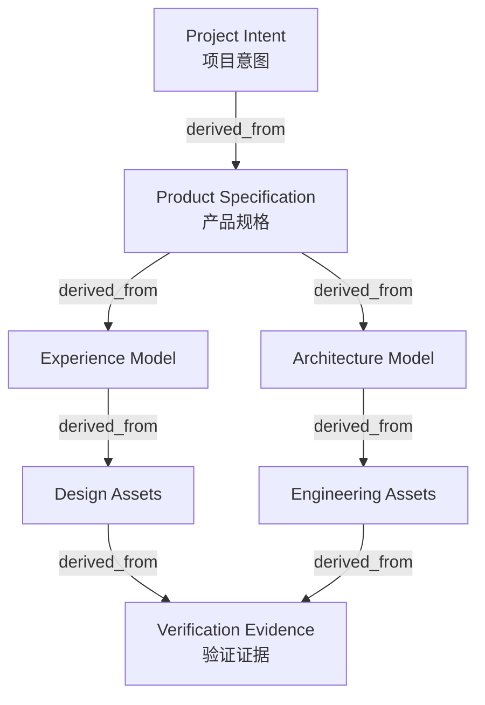
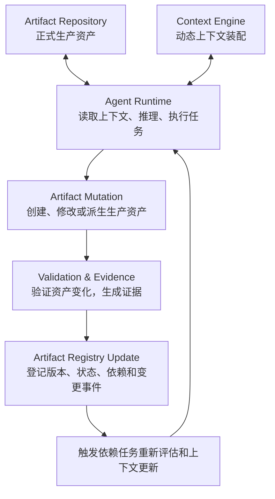

# 设计目标

一个根本问题：在一个由多个 Agent 动态协作的生产系统中，如何让所有 Agent 基于一致、可信、可追溯的生产资产进行工作，同时又能获得完成当前任务所需的准确上下文？

这里有两个核心概念：

- Artifact：生产过程中创建、修改、验证和复用的正式资产。
- Context：Agent 为完成当前任务而获取和组织的信息集合。

两者有关联，但不能混为一谈。

例如：一个 Agent 正在设计用户注册功能。

它需要读取：

- 项目目标
- 产品规格
- 用户场景
- 设计规范
- 当前任务要求
- 相关历史决策

这些信息共同构成它的 Context。而这些信息背后对应的产品规格、设计规范、架构模型和决策记录，则是不同的 Artifacts。

Artifact 是生产资产，Context 是任务执行时使用的信息视图。

# Architecture

| 序号  | 子系统                         | 职责                        |
| :-- | :-------------------------- | :------------------------ |
| 1   | Artifact Registry           | 生产资产注册、标识、元数据和检索          |
| 2   | Artifact Storage            | 资产内容存储、文件、结构化数据和可执行资产     |
| 3   | Artifact Graph              | 资产之间的来源、依赖、引用、派生和关联关系     |
| 4   | Version & State Management  | 版本、变更、生命周期、状态和历史记录        |
| 5   | Context Assembly Engine     | 根据 Agent、任务、权限和依赖动态装配上下文  |
| 6   | Context Delivery & Feedback | 向 Agent 提供上下文，记录使用情况和反馈结果 |

六个部分可理解为：

- 前四项负责管理生产资产。
- 后两项负责让 Agent 正确使用生产资产。

# Artifact 模型

## Artifact 基础模型

所有生产资产都采用统一的基础模型。不论资产是产品规格、设计文件、代码、测试用例，还是部署配置，都必须具有统一的身份和管理信息。

定义以下核心字段：

| 字段              | 含义                   |
| :-------------- | :------------------- |
| artifact_id     | 全局唯一资产标识             |
| artifact_type   | 资产类型                 |
| project_id      | 所属项目                 |
| name            | 资产名称                 |
| description     | 资产说明                 |
| version         | 当前版本                 |
| status          | 当前生命周期状态             |
| content_ref     | 实际内容存储位置             |
| schema_ref      | 所使用的数据结构定义           |
| producer        | 创建或修改该资产的 Agent / 工具 |
| source_refs     | 来源资产                 |
| dependency_refs | 依赖资产                 |
| validation_refs | 验证证据引用               |
| owner           | 维护责任主体               |
| created_at      | 创建时间                 |
| updated_at      | 更新时间                 |

一个非常重要的设计原则：Artifact 的元数据与 Artifact 的实际内容应该分离。

例如：产品规格可能有数千条结构化数据、规则和约束。Registry 只负责管理身份、元数据和索引；实际规格内容保存在适合它的数据存储系统中。

## 资产类型体系

| 图示                                                                                                                                                                                                                                                                                                                                     | 资产类型                           | 说明                        | 典型文档                                                                                                |
| :------------------------------------------------------------------------------------------------------------------------------------------------------------------------------------------------------------------------------------------------------------------------------------------------------------------------------------- | :------------------------------ | :------------------------- | :--------------------------------------------------------------------------------------------------- |
|                                                                            | A. Definition Assets<br>定义类资产  | 定义项目要做什么<br>为什么做<br>有什么约束 | Project Intent<br>Product Spec<br>Business Rules<br>Requirements<br>Acceptance Criteria             |
|                                                                        | B. Design Assets<br>设计类资产      | 定义产品<br>体验和服务如何呈现         | User Journey<br>Interaction Model<br>Design Tokens<br>UI Components<br>Service Blueprint            |
|                                         | C. Engineering Assets<br>工程类资产 | 定义并实现系统的技术结构              | Architecture Model<br>API Contract<br>Data Schema<br>Source Code<br>Infrastructure Config           |
|  | D. Execution Assets<br>执行类资产   | 支撑 Agent 执行生产任务           | Task Contract<br>Workflow Definition<br>Agent Definition<br>Skill<br>Tool Configuration             |
|                             | E. Evidence Assets<br>证据类资产    | 证明生产结果符合要求                | Test Results<br>Evaluation Results<br>Security Reports<br>Deployment Evidence<br>Acceptance Records |

举例：测试用例属于执行或工程相关资产，而测试结果属于证据资产；它们可以被多个生产域共同使用。

## Artifact Graph

传统文档体系通常以文件夹和文件组织内容

Agent-Native 生产体系不能只依赖文件夹结构，必须形成关系网络

需要支持的关系类型至少包括：

|关系|含义|
| :---| :---|
|derived_from|由某资产派生|
|depends_on|依赖某资产|
|references|引用某资产|
|implements|实现某个规格或约束|
|validates|验证某个资产|
|supersedes|替代旧版本或旧资产|
|conflicts_with|与某资产存在冲突|
|related_to|一般关联|

例如（仅供参考，不一定对）：



特别强调：依赖关系和来源关系不是一回事。

例如，代码实现可能依赖某个 API Contract，但不一定是由它直接派生的。

## Version & State Management

Version 版本 回答：这是哪个版本的资产？

State 状态 回答：这个资产当前处于什么状态？

例如：

|资产|版本|状态|
| :---| :---| :---|
|Product Spec|1.0.0|Approved|
|Architecture Model|0.9.0|Under Review|
|API Contract|1.2.0|Validated|
|Source Code|Commit abc123|Integrated|

初步生命周期可以设计为：

| 序号  | 状态                              |
| :-- | :------------------------------- |
| 1   | Draft 草稿                        |
| 2   | Under Review 审核中                |
| 3   | Validated 验证通过                  |
| 4   | Approved / Accepted 已批准 / 已接受   |
| 5   | Superseded / Archived 已替代 / 已归档 |

注意：不是所有资产都需要经过相同的状态流程，建议统一状态管理框架 + 按资产类型定义生命周期状态机。

例如：

- 代码可能经过 Draft、Tested、Integrated、Released。
- 产品规格可能经过 Draft、Validated、Approved。
- 证据资产可能经过 Generated、Verified、Accepted。

版本原则上不可变：修改已经产生的版本，应创建新版本，而不是直接覆盖历史内容。

# Context 模型

Context Assembly Engine（上下文装配引擎）：它根据 Agent 当前执行的任务，动态确定需要什么信息、从哪里获取、以什么形式提供，以及如何控制信息范围。

## Context 的六类组成

| Context 类型        | 内容                  |
| :---------------- | :------------------ |
| Project Context   | 项目目标、约束、成功标准        |
| Domain Context    | 当前涉及的业务、产品、设计或技术知识  |
| Task Context      | 当前任务目标、输入、输出要求和验收条件 |
| Artifact Context  | 当前任务需要读取的相关生产资产     |
| Execution Context | 当前执行状态、依赖、历史操作和错误   |
| Policy Context    | Agent 权限、安全要求、治理规则  |

举个例子：一个架构 Agent 正在设计支付系统。

Context Assembly Engine 应该根据任务动态提供：

- 项目目标和预算约束。
- 支付业务规则。
- 产品规格中与支付有关的部分。
- 用户流程和交互模型。
- 已有技术架构。
- 安全与合规要求。
- 当前架构设计任务的验收条件。

## 上下文装配的工作机制

| 步骤  | 工作                                                  |
| :-- | :--------------------------------------------------- |
| 1   | Task Received<br>收到任务                               |
| 2   | Context Requirements Analysis<br>分析任务所需上下文          |
| 3   | Artifact & Knowledge Retrieval<br>检索资产、知识和历史记录      |
| 4   | Relevance & Permission Filtering<br>相关性筛选、权限检查、版本校验 |
| 5   | Context Assembly<br>组合结构化上下文                        |
| 6   | Context Delivery<br>提供给目标 Agent                     |
| 7   | Usage Trace & Feedback<br>记录使用情况和执行反馈               |

**Context 必须能够追溯来源！** 否则，后续很难解释 Agent 为什么做出某个决定。

比如，当 Agent 根据某个上下文做出决定时，我们应该能够知道：

- 它读取了哪些资产？
- 使用的是哪个版本？
- 是否使用了过期信息？
- 使用了哪些外部知识？
- 当时的权限和策略是什么？

## Context 不等于 Memory

明确分开三个概念

| 概念                 | 定义          | 主要作用          |
| :----------------- | :---------- | :------------ |
| Artifact           | 正式生产资产      | 保存生产成果        |
| Context            | 当前任务的信息集合   | 支持 Agent 当前推理 |
| Memory / Knowledge | 可复用的历史经验和知识 | 支持未来任务        |

例如：一次代码构建失败

- 错误日志是 Execution Evidence。
- 当前 Agent 读取的错误日志和相关代码是 Context。
- 从多次失败中总结出来的修复经验，可以沉淀为 Knowledge 或 Skill。

不能把所有历史记录都当作长期记忆，也不能把未经验证的经验直接变成正式生产规则。

# Artifact-Context-Agent 闭环



例如，产品规格发生变化：

1. 产品 Agent 创建新版本。
2. Artifact Registry 登记新版本。
3. Artifact Graph 找到依赖该规格的设计、架构和测试资产。
4. 系统判断哪些资产受到影响。
5. Context Engine 为相关 Agent 重新装配上下文。
6. Workflow 触发重新评估或修改任务。
7. 产生新的验证证据。

整个生产体系具有真正的持续协作能力

# 统一的机器可消费数据结构示例

为了避免设计停留在概念层，先用 JSON 表达核心对象。以下是初始示例，不代表最终 Schema 已经确定。

## Artifact Metadata 示例

```
{
  "artifact_id": "art_product_spec_001",
  "artifact_type": "product_specification",
  "project_id": "project_001",
  "name": "xx项目-产品说明书",
  "description": "xx项目的产品说明书"
  "version": "1.0.0",
  "status": "approved",
  "content_ref": {
    "uri": "artifact://project_001/product-spec/001",
    "format": "application/json"
  },
  "schema_ref": "schema://product-spec/v1",
  "producer": {
    "type": "agent",
    "id": "product_agent_01"
  },
  "source_refs": [
    "art_project_intent_001"
  ],
  "dependency_refs": [
    "art_business_rules_001"
  ],
  "validation_refs": [
    "art_validation_evidence_001"
  ],
  "owner": "Jack",
  "created_at": "2026-11-18T00:00:00+09:00",
  "updated_at": "2026-11-18T00:00:00+09:00"
}
```

## Context Package 示例

```
{
  "context_id": "ctx_architecture_task_001",
  "project_id": "project_001",
  "task_id": "task_architecture_001",
  "agent_id": "architecture_agent_01",
  "context_requirements": [
    "project_constraints",
    "product_requirements",
    "business_rules",
    "security_policies"
  ],
  "included_artifacts": [
    {
      "artifact_id": "art_product_spec_001",
      "version": "1.0.0",
      "relevance": "high"
    },
    {
      "artifact_id": "art_business_rules_001",
      "version": "1.2.0",
      "relevance": "high"
    }
  ],
  "permissions": {
    "read": true,
    "write": false
  },
  "assembly_metadata": {
    "assembled_at": "2026-11-18T00:00:00+09:00",
    "policy_version": "1.0.0"
  }
}
```

未来还应该补充内容摘要、完整性校验、访问控制、数据敏感等级、有效期和上下文预算等字段。

# 生产资产生命周期与变更传播机制

Artifact 的版本与状态管理定义了资产如何保存、演进和追溯，但还需要进一步解决资产变更后如何识别影响范围、判断下游资产有效性，以及如何将变更传播至 Context 和后续生产流程。

因此，本模型将 Artifact Lifecycle & Change Propagation 作为独立的深化设计模块，专门定义：

- Artifact 完整生命周期与状态转换机制
- 版本变更与 Change Record
- 基于 Artifact Graph 的变更影响分析
- 下游资产有效性与 Evidence 失效管理
- 变更事件及传播机制
- Context 失效与更新联动
- 多 Agent 并发修改、冲突处理与资产恢复

详细设计见：[生产资产生命周期与变更传播机制](02.【研究】R2-T1-ST1-深入设计1-生产资产生命周期与变更传播机制.md)

职责边界：本模块负责识别变更、计算影响和确定需要重新评估或验证的资产；变更事件触发后的任务创建、Agent 调度、执行、重试和故障恢复由 Workflow & Runtime Model 负责。

# 七条原则

将以下原则作为后续 Schema 设计的约束。

|编号|原则|说明|
| :---| :---| :---|
|1|Single Source of Truth|每个正式资产有明确的权威版本和管理位置|
|2|Immutable Versioning|已发布版本不可被静默覆盖|
|3|Explicit Relationships|资产之间的关系必须显式记录|
|4|Context Provenance|上下文中的关键信息必须能够追溯来源|
|5|Least Privilege|Agent 只能读取和修改获授权的资产|
|6|Change Impact Analysis|资产变更能够识别下游影响|
|7|Evidence-linked State|关键资产状态变化需要相应验证或审批证据|

特别强调 Single Source of Truth：这并不意味着所有资产必须存储在一个数据库或一个工具里，而是每个资产必须能够明确识别其权威来源，避免出现多个 Agent 各自维护一份互相冲突的事实。

# 进一步建议

目前已经形成了一个相对完整的初始模型，但有三个地方不建议现在就过度设计：

**第一，不要过早决定具体存储技术。**

关系数据库、对象存储、Git、向量数据库、图数据库可以组合使用。我们应该先确定逻辑数据模型，再根据工作包5选择技术。

**第二，不要过早定义所有 Artifact Schema。**

先确定统一元数据、关系类型、生命周期和 Context Package 的基本契约。具体 Product Spec、Architecture Spec、Design Spec 等 Schema，可以在八阶段设计中逐步细化。

**第三，不要把 Context 简化为 RAG。**

RAG 只是信息检索手段之一。真正的 Context Assembly 还需要处理权限、资产版本、依赖关系、任务状态、上下文预算和来源追溯。
